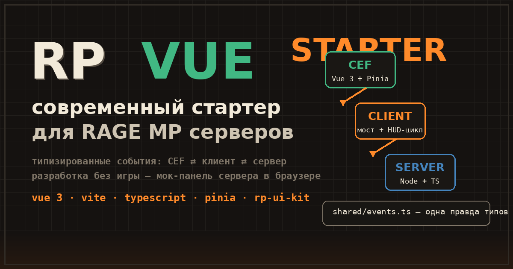

# RP VUE STARTER

Стартер для RAGE MP / GTA RP серверов: Vue 3 + Vite + TypeScript + Pinia.
Интерфейс пишешь как обычный сайт, события между интерфейсом, клиентом и сервером типизированы.



[English readme (коротко)](README.en.md)

## Зачем

На каждом RP-сервере одно и то же: поднять CEF-страницу в игре и связать её с бэкендом.
Плюс события обычно летят просто строками - опечатался в имени, и ищешь баг два часа.

Тут события описаны один раз в `shared/events.ts`. Поменял тип - TypeScript покажет
красным все места, где событие отправляется или принимается неправильно. И в интерфейсе,
и в клиенте, и на сервере.

Второе: разработка без игры. `npm run dev` открывает интерфейс в браузере,
а панель слева снизу изображает сервер: крутишь скорость, шлёшь сообщения в чат,
вызываешь «игрок зашёл». События идут тем же маршрутом, что и в игре.

Из коробки работает мини-UI: спидометр (скорость, обороты, бензин, улица), чат на кнопке T,
плашка игрока справа сверху, телефон из [rp-ui-kit](https://github.com/hilsetapp/rp-ui-kit)
как пример подключения vanilla-библиотек. Дашь себе машину командой `/veh` - HUD оживает сам.

## Попробовать

```bash
git clone https://github.com/hilsetapp/rp-vue-starter.git
cd rp-vue-starter
npm i
npm run dev
```

Открыть http://localhost:5173 - там интерфейс и мок-панель.

Ещё проще: этот же код целиком крутится в [rage-sim](https://github.com/hilsetapp/rage-sim) - браузерный эмулятор RAGE MP. Город, боты, езда на WASD, а cef, client и server - те самые файлы из этого репозитория, без правок.

## Поставить на сервер

```bash
npm run build      # получишь server-files/ - копируешь поверх скачанного сервера RAGE
npm run build:dev  # то же, но интерфейс грузится с vite - правки видны в игре сразу
```

Полная инструкция от скачивания сервера до первой поездки: **[GUIDE.md](GUIDE.md)**.

## Как устроено

```
cef/       интерфейс: Vue 3 + Vite + TS + Pinia
  src/bridge/    send() и on() с типами + браузерный мок
  src/stores/    pinia-стор игры
client/    скрипт клиента: пересылка событий, цикл спидометра, клавиши
server/    скрипт сервера: спавн, чат, команда /veh
shared/    events.ts - все события одним файлом
types/     минимальные типы RAGE MP API, дописываешь по мере надобности
scripts/   build.mjs - собирает всё в server-files/
```

## События, которые уже есть

- `ui:ready` - интерфейс примонтировался (CEF -> сервер)
- `chat:send`, `chat:focus`, `chat:blur`, `chat:push` - весь цикл чата
- `hud:update` - обновить спидометр, можно по одному полю
- `hud:flip` - F2, спрятать HUD
- `player:spawned` - id, ник, деньги

Своё событие добавляется в три места: строка в `shared/events.ts`, отправка, приём.

## Планы

- пример админ-панели
- мок под транспорт/оружие/здоровье
- ветка под alt:V (мост уже изолирован, порт небольшой)

Чего-то не хватает - [Issues](https://github.com/hilsetapp/rp-vue-starter/issues).

## Лицензия

MIT.
